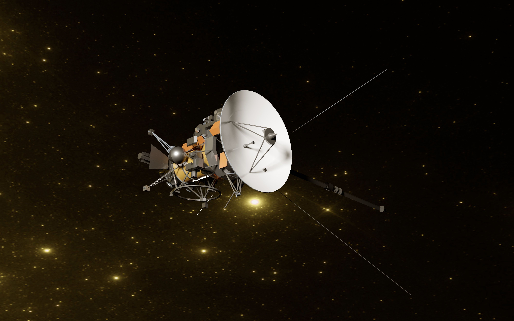
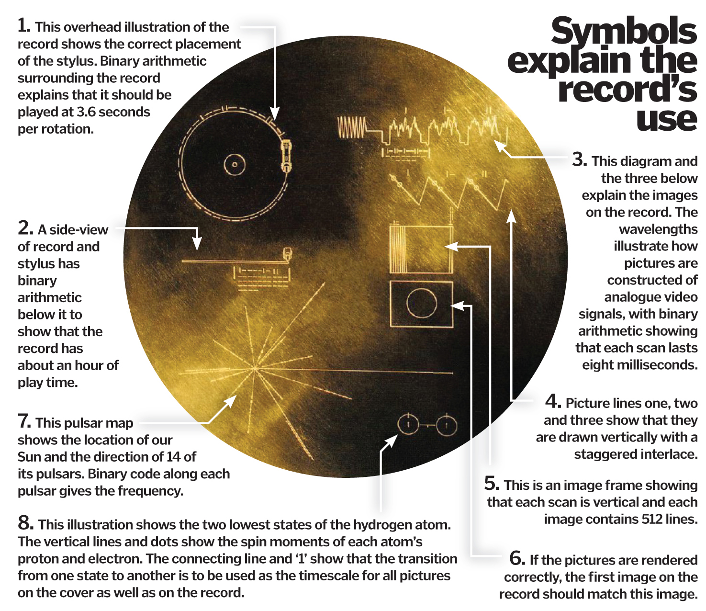

# Voyager: A Message From Earth

*An independent tribute to NASA’s Voyager 1 and Voyager 2.*

Two machines left Earth in 1977. They were called Voyager 1 and Voyager 2, and the people who built them wanted to know what lay beyond the worlds we already knew.

They flew past Jupiter and Saturn. Voyager 2 went on to visit Uranus and Neptune. Then both of them kept going, past the last of the planets and into the space between the stars.

In 1990, Voyager 1 turned its camera around and took one last picture of home. From about six billion kilometres away, Earth was a tiny point of light, smaller than a single pixel. Soon after, its cameras were switched off to save power. Neither spacecraft has taken a picture since.

They are old now, and so are many of the people who built them. Some are gone already.

Both spacecraft are more than twenty billion kilometres from home. Their power is slowly running down, and one day Earth will stop hearing from them.

But they will keep moving.

Each of them also carries a message.

It is called the Golden Record. It is a copper disc covered in gold, about thirty centimetres wide, and it plays like the records people used to listen to at home. A small team led by Carl Sagan chose what would go on it. Drawings on the cover show how to play it, in case whoever finds it has never seen a record before.

There are 115 pictures of our world. There are greetings in 55 languages, including a few that nobody speaks any more. There is about ninety minutes of music from many cultures and many times. And there are the sounds of wind, rain, thunder, waves, birds and other animals.

It is a small collection of the things we thought were worth sharing.

Perhaps someone will find these records one day. Perhaps nobody ever will. Space is very large and almost empty, and we cannot know.

We sent them anyway.

The two spacecraft will go on through the Milky Way. In about forty thousand years, Voyager 1 will pass within two light years of a star called Gliese 445, and Voyager 2 will do the same with a star called Ross 248. By then, there may be nobody left on Earth who remembers who built these machines, or why they were sent.

Somewhere in the dark, two machines built on Earth are carrying a little piece of us. Long after the people who sent them are gone, our voices may still be travelling among the stars.

**Still travelling. Still carrying us.**

The website is a small home for them on the internet: [voyager.sumitsuman.com](https://voyager.sumitsuman.com)

---

*This is an independent tribute and is not affiliated with NASA. Mission information and photographs come from NASA and JPL unless credited otherwise. The images are listed in [IMAGE-ASSETS.md](IMAGE-ASSETS.md), and the terms for using this project are in [License.md](License.md).*